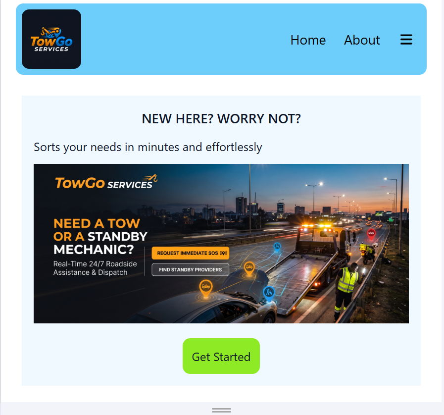

# TOWGO SERVICES

> Quality second-hand furniture and home essentials, delivered to your doorstep.


**Live demo:** https://towgoservices.vercel.app/



## Table of Contents

- [About](#about)
- [Features](#features)
- [Built with](#built-with)
- [Getting started](#getting-started)
- [Credits](#credits)
- [License](#license)

## About

Towgo Services a website that gies its user's the control to hail for breakdown services or mechanical repairs at the comfort of their mobile phones.It gives quick access and a simple UI that accomodates all.

## Features

- Intuiging Landing Page 
- Ease navigation features
- Easy to use UI
- User details with fill in forms to send SOS messages instant

## Built with

- HTML5
- Tailwind CSS

## Getting started

### Requirements

- A modern browser (Chrome, Firefox, Safari or Edge)
- [Git](https://git-scm.com/)
- [VS Code](https://code.visualstudio.com/) with the Live Server extension (optional)

### Run it locally

```bash
git clone https://github.com/wambua7/TowGO.git
cd TowGo
code .
Then right-click index.html in VS Code and choose Open with Live Server. The page opens at http://127.0.0.1:5500.
No VS Code? Just double-click index.html to open it in your browser.
```
## Project structure

```text
TowGO/
├── index.html
├── signup.html
├── login.html
├── home.html
├── about.html
├── users.html
├── assets/
├── LICENSE
└── README.md
```

## Credits

Product images: [source vecteezy]

Font Awesome

## Author

[Bryan Wambua ] (https://github.com/wambua7)

## License

This project is licensed under the MIT License - see the [LICENSE](LICENSE) file for details.


